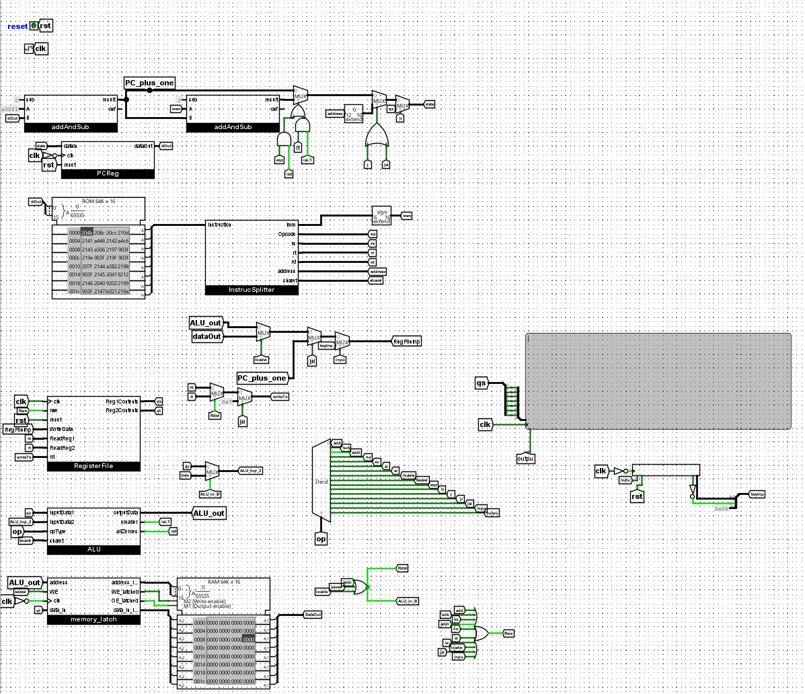
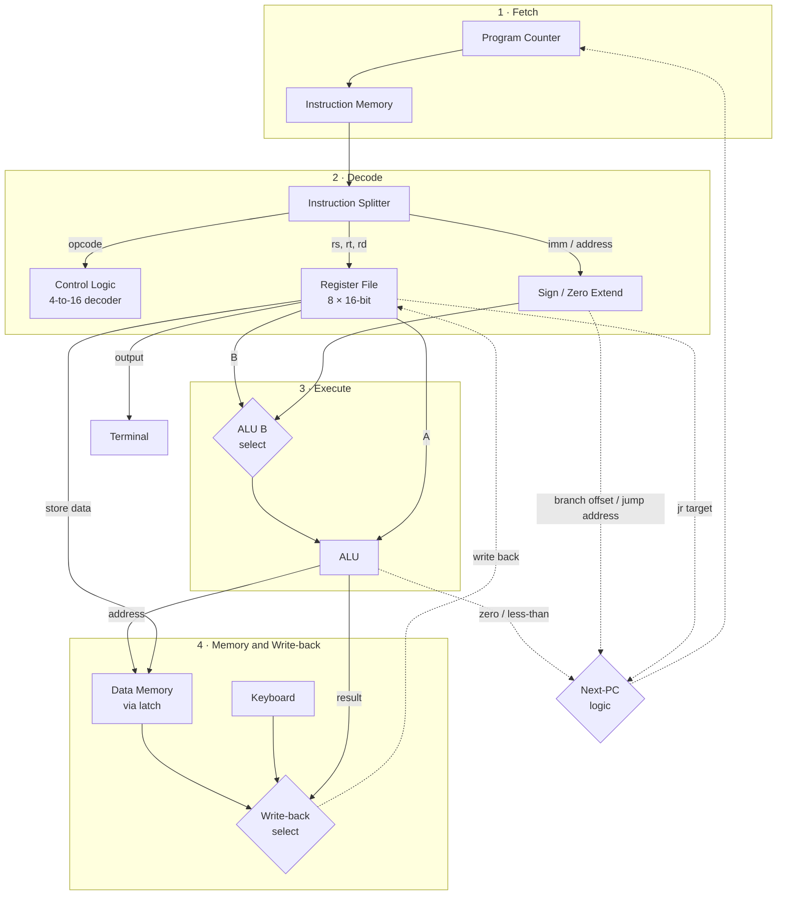

# 16-bit CPU in Logisim-evolution
 
A single-cycle 16-bit processor designed in [Logisim-evolution](https://github.com/logisim-evolution/logisim-evolution). The adder, ALU, barrel shifters, and register file are built by hand from logic gates, flip-flops, and multiplexers, while memory and I/O use Logisim's built-in RAM, ROM, keyboard, and terminal. The CPU runs programs end to end, reading keyboard input and printing to a text terminal.
 

*The top-level `main` circuit, with each block wired together. A guided tour of this view is in [Reading the main circuit](#reading-the-main-circuit).*
 
---
 
## Highlights
 
- **16-instruction ISA** covering arithmetic, logic, shifts, memory access, conditional branches, jumps, function calls, and I/O
- **Hand-built 16-bit ALU** with add, subtract, XOR, NOT, logical shifts, zero detection, and signed less-than comparison
- **Barrel shifters** for left and right shifts, each built from 48 multiplexers in three stages (shift by 0–7 in a single cycle)
- **Register file** of eight 16-bit registers (`$r0` hardwired to zero), with two read ports and one write port, built from 112 D flip-flops
- **Keyboard and terminal I/O** through dedicated `input` and `output` instructions, with an 80×13 text terminal
- **Write-safe data memory** using a latching circuit that holds address, data, and write-enable stable for a full clock cycle
- **Hierarchical design:** 13 reusable subcircuits, from a 1-bit full adder up to the full datapath
---
 
## Architecture
 

 
Each instruction is fetched, decoded, executed, and written back within a single clock cycle. The control unit decodes the 4-bit opcode into one-hot control signals that steer the multiplexers selecting the ALU operand, the write-back source, the destination register, and the next program counter.
 
---
 
## Reading the main circuit
 
The screenshot at the top shows the `main` circuit, which wires the whole processor together. Signals are passed between blocks with named tunnels (the small labeled tags), which keeps the top level readable. The circuit is organized roughly in the order an instruction flows through it:
 
| Region | What's there |
|---|---|
| **Top left** | `reset` and `clk` inputs, the `PCReg` program counter, and two `addAndSub` adders: one computes `PC + 1`, the other computes branch targets. The multiplexers and gates to their right choose the next PC from `PC + 1`, a taken branch (`beqz` / `blt`), a jump address (`j` / `jal`), or a register (`jr`). |
| **Middle left** | The 64K × 16 instruction ROM, holding the loaded program, feeding `InstrucSplitter`, which breaks each instruction into `op`, `rs`, `rt`, `rd`, `shamt`, `imm`, and `address`. The 6-bit immediate is sign-extended here. |
| **Center** | Write-back multiplexers choosing what gets written to a register (ALU result, memory data, keyboard input, or `PC + 1` for `jal`), and which register receives it (`rd`, `rt`, or `$r7` for `jal`). |
| **Lower left** | `RegisterFile`, the ALU operand multiplexer (register or immediate), the `ALU`, and the `memory_latch` driving the 64K × 16 data RAM. |
| **Center bottom** | The 4-to-16 opcode decoder, fanning out into one control line per instruction (`add`, `sub`, `addi`, … `output`). |
| **Right** | The 80 × 13 text terminal (gray) driven by the `output` instruction, and the keyboard input beneath it. Small OR gates nearby combine decoder lines into control signals such as register write-enable (`Rwe`) and ALU source select. |
 
In Logisim, black wires carry multi-bit buses and green wires carry single-bit signals (bright green is 1, dark green is 0).
 
---
 
## Instruction Set
 
### Instruction formats
 
All instructions are 16 bits wide.
 
| Format | Bits 15–12 | 11–9 | 8–6 | 5–3 | 2–0 |
|---|---|---|---|---|---|
| **R-type** | opcode | rs | rt | rd | shamt |
| **I-type** | opcode | rs | rt | imm (6-bit, sign-extended) ||
| **J-type** | opcode | address (12-bit, zero-extended) ||||
 
### Instructions
 
| Opcode | Mnemonic | Type | Operation |
|---|---|---|---|
| `0000` | `add`  | R | `rd = rs + rt` |
| `0001` | `sub`  | R | `rd = rs - rt` |
| `0010` | `addi` | I | `rt = rs + imm` |
| `0011` | `not`  | R | `rd = ~rs` |
| `0100` | `xor`  | R | `rd = rs ^ rt` |
| `0101` | `sll`  | R | `rd = rs << shamt` |
| `0110` | `srl`  | R | `rd = rs >> shamt` |
| `0111` | `lw`   | I | `rt = MEM[rs + imm]` |
| `1000` | `sw`   | I | `MEM[rs + imm] = rt` |
| `1001` | `beqz` | I | if `rs == 0`, branch by `imm` |
| `1010` | `blt`  | I | if `rs < rt`, branch by `imm` |
| `1011` | `j`    | J | `PC = address` |
| `1100` | `jr`   | R | `PC = rs` |
| `1101` | `jal`  | J | `$r7 = PC + 1`, `PC = address` |
| `1110` | `input`  | R | `rd` = next character from the keyboard |
| `1111` | `output` | R | print the character in `rs` to the terminal |
 
Branch offsets are relative to the next instruction. `jal` stores the return address in `$r7`, so `jr $r7` returns from a function call.
 
---
 
## Subcircuits
 
| Subcircuit | Description |
|---|---|
| `fullAdder` | 1-bit full adder from XOR, AND, and OR gates |
| `addAndSub` | 16-bit ripple-carry adder/subtractor (16 full adders with XOR-based two's-complement inversion) and overflow detection |
| `ALU` | Selects among add, subtract, XOR, NOT, shift-left, and shift-right; outputs zero and less-than flags |
| `leftShift` / `rightShift` | Three-stage logarithmic barrel shifters (shift by 1, 2, and 4) |
| `isZero` | 16-input zero detector |
| `lessThan` | Signed comparison that computes `A - B` and checks the sign bit of the result |
| `singleRegister` | 16-bit register from 16 D flip-flops with write-enable and reset |
| `RegisterFile` | Eight registers with decoder-driven write select and tri-state buffered read ports |
| `PCReg` | Program counter register |
| `InstrucSplitter` | Breaks a 16-bit instruction into opcode, register, immediate, shamt, and address fields |
| `memory_latch` | Latches address, data, and write-enable so memory writes happen cleanly on the clock edge |
| `main` | Top-level datapath and control |
 
---
 
## Running the CPU
 
1. Install [Logisim-evolution](https://github.com/logisim-evolution/logisim-evolution/releases) (tested with version 5.0).
2. Open `cpu.circ`.
3. The instruction ROM in `main` is preloaded with a test program. To load your own, right-click the ROM, choose **Load Image**, and select a hex file in Logisim's `v2.0 raw` format.
4. Pulse `reset`, then step the clock with **Ctrl+T** or enable automatic ticking under **Simulate → Auto-Tick Enabled**.
5. Watch the terminal for output. Click the keyboard component and type to send input.
To explore a single block, double-click any subcircuit in the explorer panel and use the Poke tool to drive its inputs.
 
---
 
## What I learned
 
- How a processor's datapath and control unit fit together, and how one opcode fans out into dozens of control signals
- Designing for a single-cycle timing model, including why memory writes need to be latched
- Building larger components out of smaller verified ones, then debugging the integrated system with probes and step-by-step clocking
- Trade-offs in arithmetic circuit design, such as ripple-carry addition versus faster approaches, and multiplexer-based shifting
---
 
## Limitations and possible improvements
 
- **Ripple-carry adder:** simple and easy to verify, but the carry must pass through all 16 bits. A carry-lookahead adder would shorten the critical path.
- **Single-cycle design:** the clock period has to cover the slowest instruction (`lw`). Pipelining would raise throughput at the cost of hazard handling.
- **Comparison:** `blt` uses only the sign of `A - B`, so it can give the wrong answer when the subtraction overflows (very large positive vs. very negative values). Checking the overflow flag as well would fix this.
- **Shift range:** the 3-bit `shamt` field limits shifts to 0–7 bits per instruction.
---
 
## Author
 
**Caleb Pucylowski**
[GitHub](https://github.com/CalebPuc) · [LinkedIn](https://www.linkedin.com/in/caleb-pucylowski)
